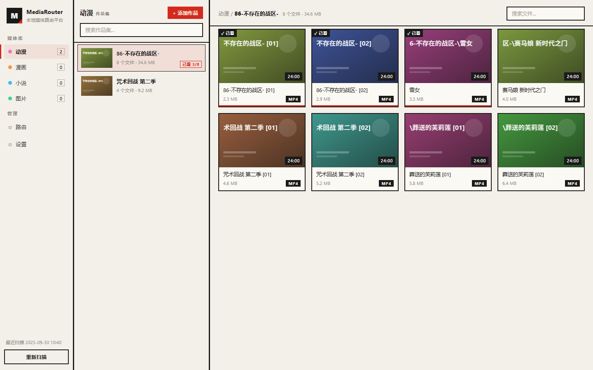
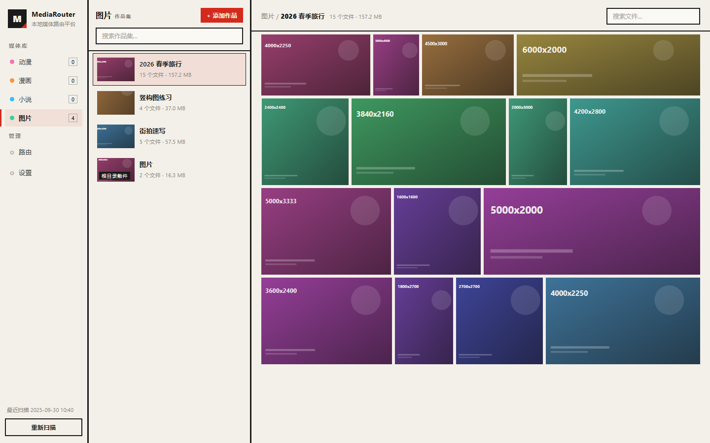
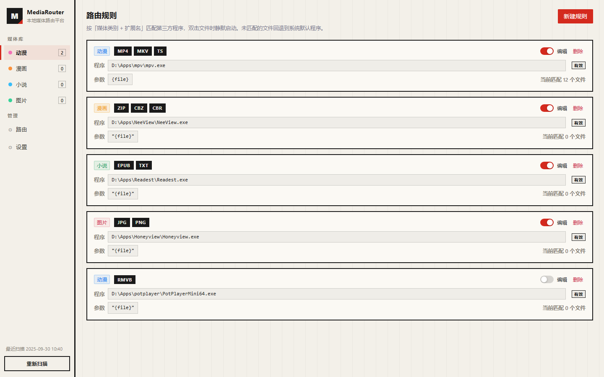

# MediaRouter

**本地媒体库 + 规则路由启动器** · Windows 桌面应用

扫描几个本地目录，聚合成作品集；点开文件时，按「分类 + 扩展名」的规则交给指定的播放器 / 阅读器打开。



## 它解决什么

本地收了一堆番剧、漫画、小说、图片，每次都要先想「这个格式该用哪个软件」，
再开软件、再翻目录找文件。MediaRouter 只做一件事：**把「用哪个程序打开」这一步自动化**。

你告诉它「动漫分类里的 `.mkv` 用 `mpv.exe` 开」「漫画分类里的 `.cbz` 用 `NeeView.exe` 开」，
之后在媒体库里点一下文件，对应的程序就静默启动并打开它。没配规则的文件交给系统默认程序。

## 功能

- **四个分类**：动漫 / 漫画 / 小说 / 图片，每类可挂多个根目录
- **三级导航**：分类 → 作品集（子目录）→ 文件网格。支持搜索、手工挂载任意目录
- **规则路由**：`分类 + 扩展名列表 → 程序 + 参数模板（{file} 占位）`，可单独启停，程序失效有提示
- **缩略图**：视频抽帧（ffmpeg）、epub 封面、zip/cbz 首图、PDF 首屏（pdf.js）、图片；全部按版本号磁盘缓存
- **图片分类用照片墙**：按容器宽度平铺填满，行内等高，末行自然留白
- **已读标记**：动漫显示「已看」，漫画 / 小说显示「已读」（图片不需要，故不提供）
- **五种主题**：暗色 / 亮色 / VS Code 暗色 / Windows 11 Fluent / 构成主义
- **排序与资源管理器一致**：直接用 Windows 的 `StrCmpLogicalW`，不是拼音排序
- **绿色便携**：数据放 exe 同级的 `MediaRouterData/`，整个文件夹搬走即可

## 截图

| 图片分类 · 平铺照片墙 | 路由规则 |
|:--:|:--:|
|  |  |

## 下载

`release/` 里有两个文件，任选其一：

| 文件 | 说明 |
|---|---|
| `MediaRouter_0.3.0_x64-setup.exe` | NSIS 安装包 |
| `MediaRouter.exe` | 免安装单文件，双击即用 |

需要 Windows 10 / 11 x64。WebView2 运行时 Win11 自带，Win10 可能需要单独装一次。

> 首次扫描大目录、或第一次浏览某个分类时会生成缩略图，需要一点时间；之后都走磁盘缓存。

## 从源码构建

| 依赖 | 版本 |
|---|---|
| Node.js | ≥ 20 |
| Rust | ≥ 1.77.2（MSVC 工具链 + Windows SDK） |
| WebView2 | Windows 自带或单独安装 |

```bash
npm install
npm run tauri:dev      # 开发（前端热更新 + 桌面窗口）
npm run tauri:build    # 出 exe 与安装包，产物在 src-tauri/target/release/
```

**可选**：把 ffmpeg 放在程序同目录（文件夹名以 `ffmpeg-` 开头），或在设置里指定路径，
视频就能抽真实帧、显示时长；没有则降级为系统缩略图。

## 用法

1. 打开「设置」，给需要的分类加一个根目录。根目录下的**每个子文件夹算一个作品集**，
   直接放在根目录里的文件归入「散件」。
2. 打开「路由」，新建规则：选分类、填扩展名（如 `mkv mp4`）、选目标程序，
   参数填 `{file}`（会替换成被点击文件的完整路径）。
3. 回到媒体库，点文件即可。

## 技术栈

| 层 | 选型 |
|---|---|
| 外壳 | Tauri v2（Rust 2021） |
| 渲染 | WebView2 + Vue 3 + TypeScript + naive-ui |
| PDF | pdf.js（渲染层 canvas 渲染首屏） |
| 视频 | 外部 ffmpeg / ffprobe（自动探测，不内置） |

```
src/                 前端（Vue）
├─ types.ts          全部类型定义
├─ api/              后端 API 门面，组件只通过它访问后端
├─ stores/           应用状态与会话缓存
├─ components/       UI 组件
└─ views/            媒体库 / 路由 / 设置

src-tauri/src/       后端（Rust）
├─ scanner.rs        目录扫描与作品集分组
├─ sort.rs           与资源管理器一致的排序
├─ imagedims.rs      图片宽高探测（只读文件头）
├─ thumbs/           缩略图生成（压缩包 / epub / 视频 / 系统）
├─ launcher.rs       规则匹配与进程启动
└─ commands.rs       全部 IPC 命令
```

`docs/engineering-notes.md` 记了实现过程中的设计取舍和踩到的上游问题，改代码前值得一读。
`tools/` 是一套无头验证工具链（用 Edge headless 跑真实前端 + 假 IPC），改 UI 时可以用它做回归。

## 已知限制

- 仅支持 Windows，仅发布 x64
- 排序跟随 Windows 资源管理器的规则，不是拼音排序（两者对中文的顺序不同，这里以资源管理器为准）
- PDF 缩略图在渲染层用 pdf.js 生成，首次较慢；生成后落盘缓存
- 没有内置 ffmpeg，需要自己放一份才有视频真实帧与时长

## 许可

[MIT](LICENSE)
